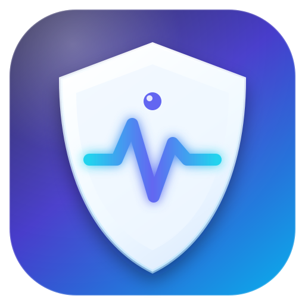
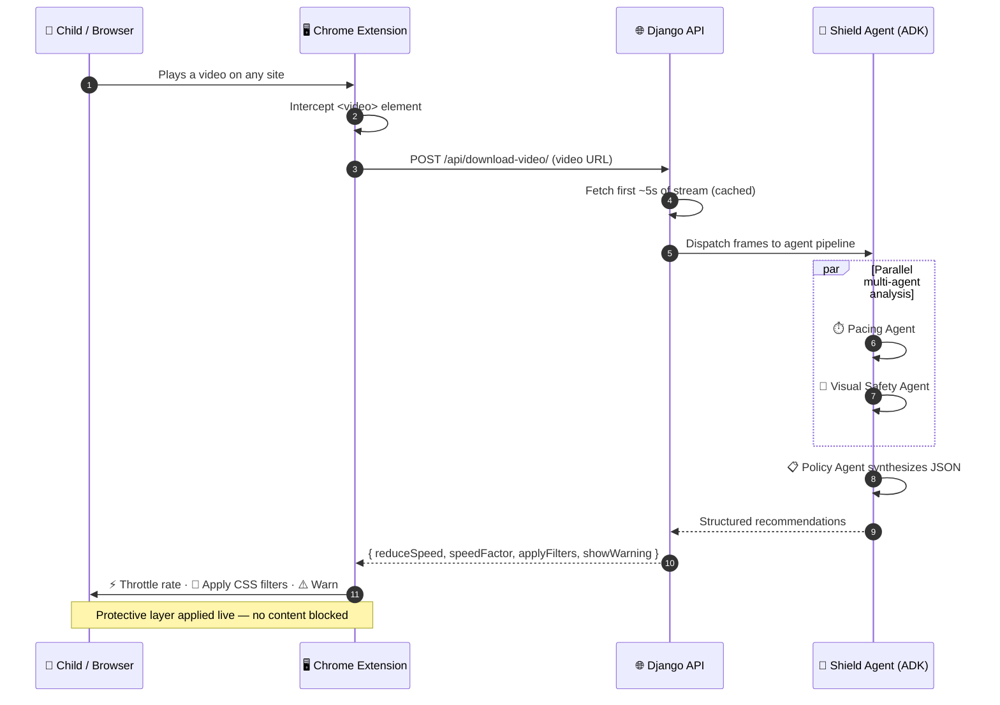
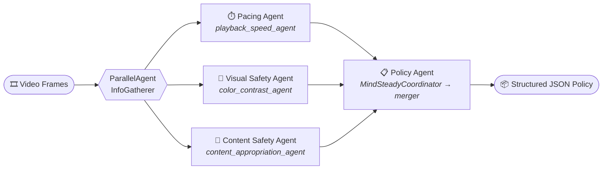

<div align="center">



# 🧠 MindSteady

### The Real-Time Runtime Shield for Children's Video Safety

**Parental controls fail because they only block explicit *text and themes* — they do nothing against hyper-stimulating video *pacing* that overloads developing brains.**

MindSteady is the first real-time, AI-powered runtime shield that intercepts video streams on the fly, using **Google ADK multi-agent pipelines** to actively throttle hyper-fast scene cuts, dampen harsh contrast, and stabilize playback **before** sensory overload happens.

<br>

[](./extension)
[](./backend)
[](./shieldagent)
[](./extension/manifest.json)

[](#-hackathon-submission)
[](#-privacy-by-design)
[](./LICENSE)
[](#-project-status)

<br>

**🚨 It doesn't just flag content. It actively intervenes — in real time, on the page, while your child watches.**

</div>

---

## 📖 Table of Contents

<details open>
<summary>Click to expand</summary>

- [🔥 The Problem: The "Passive Filter" Flaw](#-the-problem-the-passive-filter-flaw)
- [💡 The Solution: An Active Runtime Shield](#-the-solution-an-active-runtime-shield)
- [🏛️ Strategic Positioning: Two Halves of One Ecosystem](#️-strategic-positioning-two-halves-of-one-ecosystem)
- [🧩 Key Pillars](#-key-pillars)
- [🏗️ System Architecture](#️-system-architecture)
- [🔄 How It Works: The Closed-Loop Pipeline](#-how-it-works-the-closed-loop-pipeline)
- [🤖 The Shield Agent: Multi-Agent AI](#-the-shield-agent-multi-agent-ai)
- [🧠 Grounded in Neurological Research](#-grounded-in-neurological-research)
- [🔐 Privacy by Design](#-privacy-by-design)
- [🚀 Quick Start](#-quick-start)
- [📁 Project Structure](#-project-structure)
- [🧪 Demo & Testing](#-demo--testing)
- [🗺️ Roadmap](#️-roadmap)
- [🏆 Hackathon Submission](#-hackathon-submission)
- [🤝 Contributing](#-contributing)
- [📄 License](#-license)

</details>

---

## 🔥 The Problem: The "Passive Filter" Flaw

> **Traditional parental controls are a locked door on a house that's already on fire.**

Every major parental-control tool today operates on the same outdated model: **block or allow**. They scan titles, transcripts, and tags, then decide whether a video is permitted. This leaves a massive, unaddressed gap:

| ❌ What Existing Tools Catch | 🚨 What They Completely Miss |
|---|---|
| Explicit language in metadata | **Hyper-fast scene cuts** that fragment attention |
| Known banned keywords | **Strobing & flashing** that overwhelm visual processing |
| Category-based age ratings | **Extreme saturation & contrast** spikes |
| Static allow/deny lists | **Sudden volume spikes** that startle infants |
| — | **Rhythm & pacing** that dysregulates developing brains |

**The result:** a "safe" video — correctly labeled, correctly rated, correctly filtered — can still be a **sensory assault** on a toddler's developing nervous system. Existing tools have no runtime awareness of *how* content is delivered, only *what* it contains.

---

## 💡 The Solution: An Active Runtime Shield

**MindSteady does not just tell parents a video is fast — it actively steps in.**

It intercepts HTML5 `<video>` elements in real time and dynamically applies protective measures *during* playback, without ever blocking the child's experience outright.

<table>
<tr>
<th>🎯 Intervention</th>
<th>⚙️ Mechanism</th>
<th>🧠 Why It Matters</th>
</tr>
<tr>
<td><b>⏱️ Playback Throttling</b></td>
<td>Dynamically reduces playback rate to <code>0.85x</code> / <code>0.75x</code> during detected hyper-pacing</td>
<td>Gives the developing brain time to process each frame</td>
</tr>
<tr>
<td><b>🎨 Visual Dampening</b></td>
<td>Applies calming CSS filters — <code>brightness(0.8) contrast(0.9) saturate(0.7)</code></td>
<td>Reduces overstimulation from harsh contrast & saturation</td>
</tr>
<tr>
<td><b>🔇 Volume Stabilization</b></td>
<td>Lowers sudden volume spikes during intense segments</td>
<td>Prevents startle responses in infants</td>
</tr>
<tr>
<td><b>⚠️ Gentle Warnings</b></td>
<td>Non-blocking notices with a continue/skip choice</td>
<td>Keeps parents informed without surveillance</td>
</tr>
</table>

<div align="center">

### 🛡️ MindSteady = A digital **seatbelt** for cognitive development

*Not a locked door. A protective layer that moves with the child.*

</div>

---

## 🏛️ Strategic Positioning: Two Halves of One Ecosystem

MindSteady is the **active runtime shield**. It is designed to complement diagnostic tools as part of a complete media-safety ecosystem:

<table>
<tr>
<th width="50%">📊 Kiddometer</th>
<th width="50%">🛡️ MindSteady</th>
</tr>
<tr>
<td><b>The Diagnostic Engine</b></td>
<td><b>The Active Runtime Shield</b></td>
</tr>
<tr>
<td>
<ul>
<li>Pre-viewing audit</li>
<li>100% client-side DSP</li>
<li>Generates an age rating</li>
<li>Tells you <i>if</i> to watch</li>
</ul>
</td>
<td>
<ul>
<li>Live playback intervention</li>
<li>Multi-agent AI analysis</li>
<li>Real-time DOM manipulation</li>
<li>Protects you <i>while</i> you watch</li>
</ul>
</td>
</tr>
<tr>
<td align="center"><b>🩺 Diagnosis</b></td>
<td align="center"><b>💊 Active Treatment</b></td>
</tr>
</table>

> **Together:** Kiddometer *screens*, MindSteady *shields*. Two distinct layers of defense — pre-flight check and in-flight protection.

---

## 🧩 Key Pillars

<table>
<tr><td width="50%" valign="top">

### 1️⃣ ⚡ Active Intervention
**Solving the "Passive Filter" Flaw**

MindSteady doesn't stop at flagging. It intercepts HTML5 video elements in real time to **dynamically reduce playback speed**, apply **calming visual CSS overlays**, and **lower volume spikes** during detected hyper-pacing segments.

> *Real-world impact beyond simple content flagging.*

</td><td width="50%" valign="top">

### 2️⃣ 🤖 Google ADK Multi-Agent AI
**Sophisticated, meaningful AI**

Rather than a single monolithic script, MindSteady runs **parallel multi-agent analysis pipelines** built on the Google Agent Development Kit — specializing each agent on a distinct dimension of safety.

> *Pacing · Visual Safety · Policy Synthesis.*

</td></tr>
<tr><td width="50%" valign="top">

### 3️⃣ 🧠 Neurological Grounding
**Real necessity, not a gimmick**

Grounded in developmental psychology research (e.g. **Lillard & Peterson** on rapid media pacing and executive-function deficits in early childhood), MindSteady targets the *actual* mechanism of harm.

> *A protective layer for cognitive development.*

</td><td width="50%" valign="top">

### 4️⃣ 🔐 Privacy-Respecting
**Protection without surveillance**

MindSteady operates **locally on the client layer** via the browser extension. It intercepts playback without logging private viewing history, profiling the child, or tracking identity.

> *Safety that supports independence.*

</td></tr>
</table>

---

## 🏗️ System Architecture

MindSteady is a **monorepo** built as a continuous, **closed-loop feedback system** across three specialized components:

```
┌─────────────────────────┐       ┌─────────────────────────┐       ┌─────────────────────────┐
│    Chrome Extension     │       │       Django API        │       │  Shield Agent (ADK)     │
│   (DOM Interception)    │ ────► │  (Analysis & Routing)   │ ────► │  (Multi-Agent Scoring)  │
│                         │       │                         │       │                         │
│ • Intercepts <video>    │       │ • Ingests frame data    │       │ • Pacing Agent          │
│ • Executes CSS filters  │ ◄──── │ • Dispatches policy     │ ◄──── │ • Visual Safety Agent   │
│ • Controls rate (0.75x) │       │ • Stores safety logs    │       │ • JSON Policy Synthesis │
└─────────────────────────┘       └─────────────────────────┘       └─────────────────────────┘
```

### 🔧 Component Matrix

| Layer | Component | Stack | Responsibility | Status |
|:-----:|-----------|-------|----------------|:------:|
| 🖥️ **Client** | [`extension/`](./extension) | JS · HTML · CSS · Manifest V3 | Intercepts `<video>`, executes CSS filters, controls playback rate | ✅ Complete |
| 🌐 **Service** | [`backend/`](./backend) | Python · Django · DRF · yt-dlp | Ingests frame data, dispatches policy, caches safety results | 🚧 In Development |
| 🧠 **Intelligence** | [`shieldagent/`](./shieldagent) | Python · Google ADK · LiteLLM | Parallel multi-agent scoring & JSON policy synthesis | 🚧 In Development |
| 🎨 **Brand** | [`docs/`](./docs) | SVG | Logo & identity assets | ✅ Complete |

---

## 🔄 How It Works: The Closed-Loop Pipeline



### 🪜 Three-Stage Execution

<table>
<tr>
<th>Stage</th>
<th>What Happens</th>
</tr>
<tr>
<td><b>1️⃣ Interception</b></td>
<td>The Chrome Extension intercepts video elements on web pages (e.g. YouTube) and extracts live frame streams + metadata.</td>
</tr>
<tr>
<td><b>2️⃣ Analysis</b></td>
<td>The Django backend coordinates telemetry and dispatches frame data to the Shield Agent multi-agent pipeline.</td>
</tr>
<tr>
<td><b>3️⃣ Execution</b></td>
<td>The ADK agents synthesize safety recommendations into structured JSON, signaling the Extension to apply live playback-rate throttling and visual-dampening CSS in real time.</td>
</tr>
</table>

### 📡 API Contract

<details>
<summary><b>Request</b> — <code>POST /api/download-video/</code></summary>

```json
{
  "url": "https://www.youtube.com/watch?v=..."
}
```
</details>

<details>
<summary><b>Response</b> — structured policy the extension executes live</summary>

```json
{
  "reduceSpeed": true,
  "speedFactor": 0.75,
  "applyFilters": ["tone-down"],
  "showWarning": false,
  "warningMessage": ""
}
```
</details>

---

## 🤖 The Shield Agent: Multi-Agent AI

The intelligence core is a **`SequentialAgent`** pipeline built on **Google ADK**: a parallel research phase feeds a synthesis phase.



<table>
<tr>
<th>Agent</th>
<th>Model</th>
<th>Evaluates</th>
<th>Output Key</th>
</tr>
<tr>
<td><b>⏱️ Pacing Agent</b><br/><code>playback_speed_agent</code></td>
<td><code>gpt-4.1-mini</code></td>
<td>Fast movements, quick cuts, rapid scene changes, information density, motion patterns overwhelming developing visual systems</td>
<td><code>needs_slower_playback</code><br/><code>recommended_factor</code></td>
</tr>
<tr>
<td><b>🎨 Visual Safety Agent</b><br/><code>color_contrast_agent</code></td>
<td><code>gpt-4.1</code></td>
<td>High-contrast elements, bright/saturated colors, rapid color changes, flashing effects</td>
<td><code>needs_reduced_contrast</code></td>
</tr>
<tr>
<td><b>🚸 Content Safety Agent</b><br/><code>content_appropriation_agent</code></td>
<td><code>gpt-4.1-mini</code></td>
<td>Violence, frightening imagery, adult themes, scary visuals, age-inappropriate concepts</td>
<td><code>contains_inappropriate_content</code><br/><code>safety_message</code></td>
</tr>
<tr>
<td><b>📋 Policy Agent</b><br/><code>MindSteadyCoordinator</code></td>
<td><code>gemini-2.0-flash</code></td>
<td>Synthesizes all three telemetry streams into a single actionable recommendation</td>
<td><code>overall_recommendation</code></td>
</tr>
</table>

> 💡 **Why multi-agent?** Different dimensions of harm need different reasoning. Splitting pacing, visuals, and content into specialized agents yields sharper judgments than one generalist model — and the parallel architecture keeps latency low enough for real-time use.

---

## 🧠 Grounded in Neurological Research

MindSteady is not built on vibes — it targets a documented developmental mechanism.

<table>
<tr><th>🔬 Finding</th><th>🎯 Design Response</th></tr>
<tr>
<td><b>Rapid media pacing</b> is associated with measurable <b>executive-function deficits</b> in early childhood (Lillard &amp; Peterson).</td>
<td>⏱️ The Pacing Agent actively throttles playback speed during hyper-paced segments.</td>
</tr>
<tr>
<td><b>Strobing, flashing, and extreme contrast</b> overwhelm the developing visual system.</td>
<td>🎨 The Visual Safety Agent triggers real-time CSS dampening filters.</td>
</tr>
<tr>
<td><b>Sudden volume spikes</b> trigger startle responses in infants.</td>
<td>🔇 Volume stabilization lowers abrupt intensity.</td>
</tr>
<tr>
<td><b>Cognitive load</b> from dense, fast-cut content degrades attention and self-regulation.</td>
<td>🧩 Combined interventions reduce net sensory load in real time.</td>
</tr>
</table>

---

## 🔐 Privacy by Design

MindSteady is built to protect children **without surveilling them**.

| ✅ What We Do | 🚫 What We Never Do |
|---|---|
| Analyze video **metadata & frames** locally / on your own backend | Upload or store the child's **viewing history** |
| Keep user settings in **browser-local storage** | Build a **profile** of the child |
| Operate on the **client layer** for intervention | Track **identity**, location, or personal data |
| Communicate over **HTTPS-only** endpoints | Sell or share any data |

> **"Parental tools that support safety without excessive surveillance."** — aligned with the hackathon's own guidance.

---

## 🚀 Quick Start

### 📋 Prerequisites

| Tool | Version | Purpose |
|------|---------|---------|
| 🟢 Node.js | 16+ | Extension tooling |
| 🐍 Python | 3.8+ | Backend & agents |
| 🌐 Chrome | Latest | Extension host |
| 🔧 Git | Any | Version control |

### 1️⃣ Clone

```bash
git clone https://github.com/robloxsagax-web/MindSteady.git
cd MindSteady
```

### 2️⃣ Load the Chrome Extension

```bash
# 1. Open chrome://extensions/
# 2. Enable "Developer mode" (top-right)
# 3. Click "Load unpacked"
# 4. Select the extension/ folder
```

### 3️⃣ Run the Backend API

```bash
cd backend
pip install -r requirements.txt
python manage.py migrate
python manage.py runserver        # → http://127.0.0.1:8000
```

### 4️⃣ Run the Shield Agent

```bash
cd shieldagent
pip install -r shield_agent/requirements.txt
# Configure your LLM provider keys (LiteLLM), then run the ADK pipeline
```

---

## 📁 Project Structure

```
MindSteady/
│
├── 🖥️ extension/                 # Chrome Extension (Manifest V3)
│   ├── manifest.json             # Extension configuration
│   ├── icons/                    # Brand icons (16/32/48/128)
│   └── src/
│       ├── content.js            # Video detection & live DOM manipulation
│       ├── background.js         # Service worker — API communication
│       ├── popup.html / popup.js # Control panel UI
│       └── styles.css            # Calming overlay & filter styles
│
├── 🌐 backend/                   # Django REST API
│   ├── manage.py
│   └── mindsteady_backend/
│       ├── views.py              # /api/download-video/ endpoint
│       ├── ai.py                 # Analysis bridge
│       └── settings.py           # Django configuration
│
├── 🤖 shieldagent/               # Google ADK agent pipeline
│   └── shield_agent/
│       ├── agent.py              # Parallel + synthesis agents
│       └── requirements.txt
│
└── 🎨 docs/                      # Brand assets
    ├── logo.svg
    └── logo-small.svg
```

---

## 🧪 Demo & Testing

<table>
<tr><th>Scenario</th><th>Expected Behavior</th></tr>
<tr><td>▶️ Safe content</td><td>Normal playback — no intervention</td></tr>
<tr><td>⚠️ Moderate content</td><td>Reduced speed + calming visual filters</td></tr>
<tr><td>🛑 Risky content</td><td>Warning dialog + pause, with continue/skip choice</td></tr>
</table>

```bash
# 1. Load the extension (see Quick Start)
# 2. Visit any site with video (YouTube, news, social)
# 3. Open the popup → watch live detection stats
# 4. Press F12 → follow the "MindSteady:" console trace
```

---

## 🗺️ Roadmap

- [x] 🖥️ Chrome Extension with real-time video interception
- [x] ⚡ Live playback throttling & CSS dampening
- [x] 🤖 Google ADK multi-agent pipeline
- [x] 🌐 Django analysis & routing API
- [x] 🎨 Premium brand identity
- [ ] 📊 Real-time frame-level pacing telemetry
- [ ] 🔇 Audio spike detection & stabilization
- [ ] 👨‍👩‍👧 Parent dashboard with aggregate (non-identifying) insights
- [ ] 🌍 Multi-language safety policies
- [ ] 🧩 SDK for third-party platforms

---

## 🏆 Hackathon Submission

<div align="center">

### 🛡️ Child Safety in AI — STEMSisterz

**Create apps that address the sociotechnical challenges of protecting children in the age of AI.**

</div>

<table>
<tr><th>Judging Criterion</th><th>Weight</th><th>How MindSteady Delivers</th></tr>
<tr>
<td><b>⚙️ Technical Execution</b></td>
<td align="center"><b>25%</b></td>
<td>Working monorepo: real DOM interception, live playback control, Django API, and a functioning ADK multi-agent pipeline.</td>
</tr>
<tr>
<td><b>🤖 AI Relevance</b></td>
<td align="center"><b>20%</b></td>
<td>Genuine multi-agent architecture (parallel specialist agents + policy synthesis) — not a single wrapped API call.</td>
</tr>
<tr>
<td><b>🎯 Usefulness</b></td>
<td align="center"><b>15%</b></td>
<td>Solves the concrete "passive filter" gap: intervention, not just flagging.</td>
</tr>
<tr>
<td><b>🌍 Impact</b></td>
<td align="center"><b>15%</b></td>
<td>Grounded in developmental research; scalable across every site with HTML5 video.</td>
</tr>
<tr>
<td><b>✨ Creativity</b></td>
<td align="center"><b>15%</b></td>
<td>Runtime intervention model + closed-loop feedback architecture is genuinely differentiated.</td>
</tr>
<tr>
<td><b>🎤 Presentation</b></td>
<td align="center"><b>10%</b></td>
<td>Clear problem framing, architecture diagrams, and a live demo of real interventions.</td>
</tr>
</table>

### 📦 Submission Checklist

| Item | Status |
|------|:------:|
| 📝 Project overview | ✅ This README |
| 💻 Public code repository | ✅ GitHub |
| 🎥 Demo video (1–3 min) | ⏳ To record |
| 🧪 Tested MVP | ✅ Working prototype |

---

## 🤝 Contributing

1. 🍴 Fork the repository
2. 🌿 Create a feature branch (`git checkout -b feature/amazing-feature`)
3. ✅ Follow component-specific guides & code standards
4. 🧪 Run tests and ensure quality
5. 🚀 Submit a pull request with a detailed description

| Standard | Tooling |
|----------|---------|
| JavaScript | ESLint + Prettier |
| Python | Black + Flake8 |
| Commits | Conventional, imperative mood |

---

## 📄 License

Released under the **MIT License** — see [LICENSE](./LICENSE) for details.

---

<div align="center">

### 🛡️👶 MindSteady

*Protecting developing minds — one video at a time.*

**Built with ❤️ for the Child Safety in AI Hackathon**

[](#)
[](./shieldagent)

</div>
